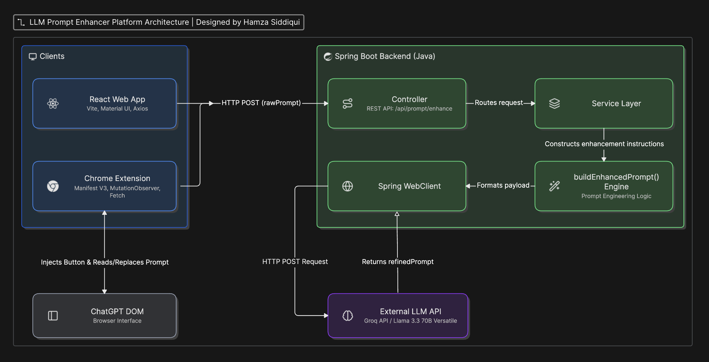

# LLM Prompt Enhancer

A full-stack AI platform that seamlessly injects a native enhancement engine directly into the ChatGPT interface. Instead of forcing users to switch tabs, the flagship Chrome Extension places a custom button inside the ChatGPT composer—automatically reading your raw thoughts, routing them through a centralized Spring Boot backend, and instantly replacing the text in your typing area with a highly structured prompt designed for maximum LLM reasoning performance.

## Tech Stack

## Architecture Overview
This system operates on a decoupled client-server architecture:

*   **Backend:** Spring Boot REST API utilizing WebClient for asynchronous, non-blocking HTTP requests to the Groq API (openai/gpt-oss-20b).
*   **Web Client (Frontend):** A React/Vite web application utilizing Material UI for a polished, standalone prompt-engineering dashboard.
*   **Extension Client:** A Manifest V3 Chrome Extension that injects a native-feeling UI directly into ChatGPT. It bypasses complex React hydration conflicts by utilizing a MutationObserver with idempotent injection guards to maintain state across SPA navigations.

## Repository Structure
*   `/backend` - Spring Boot Java 17 application (Controller, Service, CORS configuration)
*   `/frontend` - React 18, Vite, Material UI web application
*   `/extension` - Manifest V3 Chrome Extension (Content scripts, CSS, DOM observers)

## Local Development Setup

### 1. Start the Backend API
1. Navigate to the `/backend` directory.
2. Ensure you have your Groq API key configured in `application.properties`: `groq.api.key=YOUR_API_KEY`
3. Run the Spring Boot application: `./mvnw spring-boot:run` *(Server runs on `http://localhost:8080`)*

### 2. Start the React Web App
1. Navigate to the `/frontend` directory.
2. Install dependencies: `npm install`
3. Start the Vite dev server: `npm run dev` *(App runs on `http://localhost:5173`)*

### 3. Load the Chrome Extension
1. Open Chrome and navigate to `chrome://extensions/`.
2. Enable **Developer mode** (top right).
3. Click **Load unpacked** and select the `/extension` directory.
4. Open ChatGPT to see the enhancement engine natively injected into the composer.
